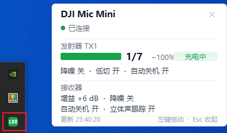

# DJI Mic Mini Monitor

**中文** · [English](README.en.md)

在 Windows 上读取大疆 **DJI Mic Mini** 接收器通过 USB 上报的实时状态：发射器电量、是否在充电、降噪/低切/自动关机开关、接收器增益。附带一个常驻任务栏右下角的托盘小部件，和一个 1 Hz 的电量/充电监控工具。

> 非官方项目，与 DJI 无任何关联。协议为社区逆向所得，固件升级后可能失效。



左侧红框是任务栏上的托盘图标，电量数字直接画在图标上（充电绿 / ≤15% 红 / ≤35% 琥珀 / 其他蓝）；右侧是左键打开的面板。

## 功能

- **电量读数**：发射器电量档位（7 档）、估算百分比、充电状态、发射器是否在线
- **状态读数**：降噪、低切、自动关机、指示灯关闭；接收器增益、降噪、自动关机、立体声跟踪
- **托盘小部件**：无边框卡片贴在工作区右下角，可拖动、位置记忆、单实例；图标即电量数字，左键开合面板，右键菜单
- **触点抖动检测**：1 分钟内充电位翻转 ≥3 次，面板状态行转琥珀色提示「触点接触不稳」——这是本项目诞生的直接原因
- **1 Hz 监控**：`charge_monitor.py` 每秒采样一次并写 CSV，换线材/换充电头时可直接对比
- **零第三方依赖**：读取部分只用了标准库 `ctypes`，直接调 `winusb.dll`

## 前提

| 项目 | 要求 |
|---|---|
| 系统 | Windows 10 / 11 x64 |
| 设备 | DJI Mic Mini 接收器（一发一收、两发一收均可），USB 线插到电脑 |
| 运行环境 | Python 3.9+，**需要带 tkinter**（python.org 官方安装包默认包含） |
| 官方软件 | 不需要，也不用装 DJI Mimo |

已验证：Windows 10 22H2 + 一发一收套装 + 接收器固件为当前最新版。

## 直接下载 exe（不需要 Python）

只想要工具、不想折腾环境的，用发布包：

1. 从 [Releases](../../releases/latest) 下载 `DJIMicMiniTray-v1.0.0-win64.zip`，**解压到任意目录**（不要在压缩包里直接双击）
2. 右键 `driver\install_winusb.bat` → 以管理员身份运行（只需一次）
3. 双击 `DJIMicMiniTray.exe`

单文件（约 19 MB）、免安装、不需要 Python 和任何依赖。首次启动有几秒解压时间属正常；包内 `使用说明.txt` 有完整说明。

> 单文件 exe 没做代码签名，少数杀软会误报，这是 PyInstaller 打包的常见现象，不是木马。介意的话用下面的源码方式运行。

## 快速开始（源码方式）

### 1. 给接收器的厂商接口绑 WinUSB（一次，需管理员）

```bat
driver\install_winusb.bat        &rem 右键 -> 以管理员身份运行
```

脚本会创建一个本机自签代码签名证书，签好驱动目录文件再安装，**不需要重启，也不需要关闭驱动程序强制签名**。原因是这个驱动包里没有任何二进制，只是把接口重定向到微软自己的 `winusb.sys`。

只影响 `MI_06`（状态通道）。音频（`MI_01`）和 HID（`MI_00`）保持系统自带驱动不变。

撤销：

```bat
driver\uninstall_winusb.bat      &rem 删除驱动包 + 移除自签证书
```

### 2. 建 Python 环境

```powershell
powershell -ExecutionPolicy Bypass -File scripts\setup.ps1
```

会创建 `.venv` 并安装 `pystray` + `Pillow`（仅托盘需要）。

### 3. 启动

```bat
scripts\run-tray.bat
```

图标出现在任务栏，左键打开面板。

## 用法

### 托盘小部件

| 操作 | 效果 |
|---|---|
| 左键图标 | 打开 / 收起面板 |
| 右键 → 显示面板 | 同上 |
| 右键 → 复位到右下角 | 面板跑出屏幕时用 |
| 右键 → 图标上显示电量数字 | 在「数字」和「电池图形」两种图标间切换 |
| 右键 → 开机自动运行 | 写 `HKCU\...\Run`，可随时取消 |
| 右键 → 退出 | 关闭（**脚本要读接口前必须先退出它**） |
| 面板内左键拖动 / `Esc` | 移动 / 收起 |

### 命令行

```bash
python src/micbattery.py           # 一次快照
python src/micbattery.py --watch   # 每 2 秒刷新
python src/micbattery.py --json    # 机器可读，适合脚本消费
```

输出示例：

```
TX1  电量 ####...  4/7  ~55%
     降噪 关   低切 开   自动关机 开
接收器增益 +6 dB   降噪 关   自动关机 开
```

### 监控（排查线材 / 触点）

```bash
python src/charge_monitor.py 60 --label 原装短线     # 跑 60 秒，打标签
python src/charge_monitor.py --raw                  # 额外打印 TX 字节
python src/dock_check.py 25                         # 只盯充电位变化
```

每秒一行，充电位或档位变化时在行尾打标记，结束时给出「充电占比 + 首末档位」判定，并自动写 `charge_log_MMDD_HHMMSS.csv`。

## 自己构建 exe

```powershell
powershell -ExecutionPolicy Bypass -File scripts\setup.ps1       &rem 首次：建 .venv
powershell -ExecutionPolicy Bypass -File scripts\build_exe.ps1   &rem 打包
```

产出：

| 路径 | 内容 |
|---|---|
| `release\bin\DJIMicMiniTray.exe` | 单文件 exe（单文件、无控制台、已嵌入图标与版本信息） |
| `release\DJIMicMiniTray-v1.0.0-win64\` | exe + `driver\` + `使用说明.txt` |
| `release\DJIMicMiniTray-v1.0.0-win64.zip` | 上面那个目录的压缩包，适合挂到 GitHub Releases |

PyInstaller 会在第一次构建时自动安装。版本号用 `-Version` 指定：`build_exe.ps1 -Version 1.1.0`。
图标由 `scripts/make_icon.py` 用 Pillow 画出来（4 倍超采样再降采样），改配色就改里面的 `GREEN`。

## 能读到什么、读不到什么

| 数据 | 状态 |
|---|---|
| 发射器电量档位（1 满 → 7 空） | ✅ 可读 |
| 发射器充电中 / 未充电 | ✅ 可读 |
| 降噪、低切、自动关机、指示灯 | ✅ 可读 |
| 接收器增益、降噪、自动关机、立体声跟踪 | ✅ 可读 |
| 发射器精确百分比 | ❌ 固件里只有 3 bit / 7 档，百分比是估算 |
| **接收器自身电量** | ❌ 该字段只在旧版 v1 帧里，当前固件只发 v2 |
| 实时音频电平 | ✅ 帧里有（23 字节的电平帧），本项目未解析 |

## 工作原理

接收器是复合 USB 设备（`VID_2CA3 & PID_4011`）。状态流走 `MI_06` 接口的 Bulk 端点（OUT `0x06` / IN `0x86`），设备主动每秒推送若干帧，帧尾是 CRC16。电量在状态帧的发射器槽位偏移 `+7`：bit 2–4 是档位、bit 1 是充电位。

**HID 那条路走不通**：`MI_00` 上的两个厂商自定义 collection 能正常打开，但读不到任何数据、写入一律报 87，它们不承载这条数据流。

完整帧格式、字段偏移、CRC 参数，以及 Windows 侧三个坑（必须异步句柄、结构体不能紧凑对齐、超时必须 `CancelIoEx`）都写在 **[docs/PROTOCOL.md](docs/PROTOCOL.md)**。

## 常见问题

**装完还是黄色感叹号 / Problem 28**
确认接收器插着且没有别的程序占用接口。仍失败就看脚本打印的 `signature status`，不是 `Valid` 说明签名环节没过。

**`WinUsb_Initialize failed, err=6`**
不是句柄问题。WinUSB 要求设备句柄以 `FILE_FLAG_OVERLAPPED` 打开，本项目的实现已处理；如果你在改代码，注意别把句柄打开方式改回同步。

**充电状态一直显示「否」**
先用 `dock_check.py` 判断：把发射器拿离底座再放回，看充电位是否跟着变。
- 全程「否」→ 底座没供电，或触点没接触上
- 拿起来「否」、放回「是」→ 接触良好，只是当时没在充
- 本项目实测遇到的就是**触点接触不良**：换线没用，把发射器在底座上挪正一点立刻变「是」。这也正是面板做抖动检测的原因

**托盘图标不见了**
可能只是被折进了任务栏的隐藏区域。再运行一次 `run-tray.bat` 不会有反应（单实例保护），先从隐藏区域拖出来。

**跑监控脚本报读取失败**
托盘小部件正占着 `MI_06`。右键托盘 → 退出，再跑脚本。

## 致谢与引用

本项目的协议知识来自以下开源工作，特此列出并致谢。**没有复制其中任何代码**，`micbattery.py` 的实现是用 Python `ctypes` 直接调 WinUSB 独立完成的；帧格式与字段语义依据其公开文档，并已在本机设备上逐字节实测校验（CRC 残差、长度、偏移全部吻合）。

| 项目 | 作者 | 许可证 | 本项目如何使用 |
|---|---|---|---|
| [ShadowBitBasher/DJI-Mic-Control](https://github.com/ShadowBitBasher/DJI-Mic-Control) | **ShadowBitBasher** | Unlicense（公有领域） | **主要来源**。其 `PROTOCOL.md` 提供了帧结构、命令集与字段定义；[docs/PROTOCOL.md](docs/PROTOCOL.md) 在此基础上整理并补充实测结论 |
| [caballeropedro/dji-mic](https://github.com/caballeropedro/dji-mic) | **caballeropedro** | 未声明许可证（保留所有权利） | 交叉验证协议理解。仅参考思路，未使用其代码 |
| [usokawa/dji-mic-mo](https://github.com/usokawa/dji-mic-mo) | **usokawa** | BSD-2-Clause | 交叉验证协议理解。仅参考思路，未使用其代码 |
| [w1ne/stereo-bridge](https://github.com/w1ne/stereo-bridge) | **w1ne** | Apache-2.0 | 背景参考：不经接收器、Android 直收双 TX 的 LC3 流。本项目未使用 |
| [WilliamPrime/DJI-mic-mini-dongle-replacement](https://github.com/WilliamPrime/DJI-mic-mini-dongle-replacement) | **WilliamPrime** | GPL-3.0 | 背景参考：替代原厂 USB-C 手机连接头的硬件方案。本项目未使用 |
| [flight-commander/dji_mic2_firmware](https://github.com/flight-commander/dji_mic2_firmware) | **flight-commander** | 未声明许可证 | 背景参考：Mic 2 固件存档。本项目未使用 |
| [pbatard/libwdi](https://github.com/pbatard/libwdi)（Zadig） | **Pete Batard** | GPL-3.0 | 未捆绑。它是给同类接口绑 WinUSB 的通用工具，本项目改用自签 INF 的零下载方案，故未依赖 |

运行时依赖（由 `scripts/setup.ps1` 安装，不随仓库分发）：

| 依赖 | 作者 / 维护者 | 许可证 | 用途 |
|---|---|---|---|
| [pystray](https://github.com/moses-palmer/pystray) | **Moses Palmér** | LGPLv3 | 托盘图标与右键菜单 |
| [Pillow](https://python-pillow.org/) | **Jeffrey A. Clark 及 Pillow 贡献者** | MIT-CMU | 图标绘制 |
| [CPython](https://www.python.org/) / `tkinter` | **Python Software Foundation** | PSF License | 面板 UI |
| [PyInstaller](https://pyinstaller.org/) | **Hartmut Goebel、Giovanni Bajo、David Vierra、David Cortesi、Martin Zibricky 及 PyInstaller 开发团队** | GPL-2.0-or-later，附带 bootloader 例外条款（允许打包分发闭源/任意许可的程序） | 仅构建期使用：把托盘小部件打成单文件 exe |

如果上面的归属或授权信息有误，请开 issue 指正，会尽快更正。

## 已知限制

- 只支持 Windows：实现直接用 `winusb.dll` / `setupapi`。macOS 与 Linux 不需要装驱动，用户态可直接访问厂商接口，但本项目没做移植
- 只读，不写入。改降噪、改增益这类写操作没有实现（要写需要构造带 CRC 的命令帧，参考上面第一个项目的命令集）
- 只验证过「一发一收」。两发一收在协议上支持（状态帧 86 / 118 字节对应 1 / 2 个 TX），代码已按槽位循环解析，但未实测
- 电量档位是 7 档，界面上的百分比是估算值，不是设备真实百分比
- 接收器自身电量读不到（见上表）

## 许可

[MIT](LICENSE)。注意其中的协议文档 `docs/PROTOCOL.md` 源自 Unlicense 的社区文档，文中已注明出处。

## 免责声明

本项目会向系统安装一个**本机自签**的驱动包，并把对应证书加入「受信任的根证书颁发机构」与「受信任的发布者」。这是绑定 `winusb.sys` 的必要步骤，`uninstall_winusb.bat` 可完整撤销。

安装第三方驱动、修改设备绑定的操作请自行评估风险。本项目按 MIT 许可「按原样」提供，不对设备损坏、数据丢失、保修失效等后果承担责任。
